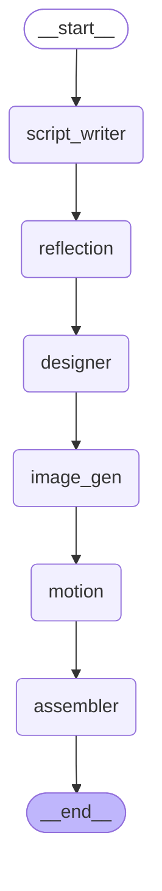

# Storyboard Agent

An agentic service that turns a text prompt into a **polished vertical (9:16) short-form (30/60s)
video** — an ordered set of AI-generated frames with **subtitle captions**, optional motion-engine
clips, **crossfades**, and an optional **TTS voiceover**, assembled into an mp4.

Backend-first and fully testable with curl/Postman. Built on **LangGraph** (multi-stage agent
pipeline), **Gemini** for image + voice generation, **Postgres** for job/artifact metadata, and
**ffmpeg** for video assembly.

```
POST /storyboard ─▶ job_id
        │  (background: minutes of work)
        ▼
  script_writer ─▶ reflection ─▶ designer ─▶ image_gen ─▶ motion ─▶ assembler ─▶ storyboard.mp4
   (Gemini LLM)     (LLM judge/    (style bible  (Gemini img,  (ffmpeg: Ken Burns zoom +
                     revise loop)   + style_ref)  conditioned   crossfades + caption overlay
                                                  on style_ref, + optional voiceover)
                                                  bounded pool)
        │
        ▼
  Postgres: jobs + artifacts (metadata + file paths only)
  Filesystem (ARTIFACT_ROOT): script.json, shotlist.json, style_bible.md,
                              style_ref.png, frame_NN.png (clean),
                              narration.wav (if TTS), storyboard.mp4
GET  /storyboard/{id}         ─▶ status + STAGES + artifacts
GET  /storyboard/{id}/logs    ─▶ per-stage log lines (paginated; the "expand" view)
GET  /storyboard/{id}/events  ─▶ SSE: live status + stage + log stream
GET  /storyboard/{id}/video   ─▶ mp4
POST /storyboard/{id}/resume  ─▶ continue an interrupted/failed job
```

**Pipeline graph**, rendered straight from the real LangGraph `StateGraph` via
`python -m scripts.render_pipeline_diagram` (so it can never drift from the actual node wiring;
`motion` only appears when `MOTION_ENGINE_ENABLED=true`):



**Consistency (anti-"AI slop"):** the `designer` writes one `style_bible.md` and renders a single
`style_ref.png`; every frame is generated conditioned on that reference image, so characters and
palette stay consistent instead of drifting frame-to-frame.

**Frame count scales with duration:** 1 frame per `SECONDS_PER_FRAME` (default 2s) → **15 frames
for 30s, 30 for 60s**, each held ≥2s so captions are readable.

> **Runs with no API key out of the box** in *mock mode* — deterministic placeholder frames so you
> can exercise the whole pipeline locally before adding `GEMINI_API_KEY`.

---

## Prerequisites

- Python 3.11+
- Docker (for local Postgres) — or your own Postgres
- `ffmpeg` on your PATH (`brew install ffmpeg` on macOS)

## Setup

```bash
# 1. Clone + enter
cd storyboard_agent

# 2. Virtualenv + install
python -m venv .venv
source .venv/bin/activate
pip install -e ".[dev]"

# 3. Env
cp .env.example .env
#   - Leave GEMINI_API_KEY blank to run in MOCK mode (placeholder frames).
#   - Add your AI Studio key later for real generation.

# 4. Start Postgres (pgAdmin 4: host=localhost port=5432 user/pass/db=storyboard)
docker compose up -d

# 5. Create schema
alembic upgrade head

# 6. Run the service
uvicorn app.main:app --reload
```

> **Note on `--reload`:** it restarts the process on file changes. Because jobs run in-process, a
> restart mid-job is detected on startup and that job is marked `interrupted` (not left hanging).

## Local testing (curl)

```bash
# Kick off a job
curl -s -XPOST localhost:8000/storyboard \
  -H 'content-type: application/json' \
  -d '{"prompt":"a lonely robot finds a flower","duration":30}'
# -> {"job_id":"<uuid>","status":"queued"}

# Poll status (artifacts include any degraded frames + warnings)
curl -s localhost:8000/storyboard/<job_id> | python -m json.tool

# Download the video once status is completed / completed_with_warnings
curl -o out.mp4 localhost:8000/storyboard/<job_id>/video

# Resume an interrupted/failed job (e.g. after a crash mid-generation).
# Idempotent: finished frames are reused, only the missing ones are regenerated.
curl -s -XPOST localhost:8000/storyboard/<job_id>/resume
# -> 202 (resuming) | 409 (already running / already finished) | 404 (unknown)
```

### Live status & per-stage logs (front-end ready)

While a job runs you can watch *which stage is executing*, how far image generation has gotten, and
the exact log lines for each stage — by polling or by subscribing to a live stream.

```bash
# Collapsed view: GET /{id} now carries `current_stage` + a `stages[]` summary
curl -s localhost:8000/storyboard/<job_id> | python -m json.tool
#   "current_stage": "image_gen",
#   "stages": [ {"name":"script_writer","status":"succeeded", ...},
#               {"name":"image_gen","status":"running",
#                "progress_current":7,"progress_total":15}, ... ]

# Expanded view: one stage's log lines (paginate with ?after=<last id>)
curl -s 'localhost:8000/storyboard/<job_id>/logs?stage=image_gen' | python -m json.tool

# Live stream (Server-Sent Events) — the front end's subscribe path
curl -N localhost:8000/storyboard/<job_id>/events
```

The SSE stream emits four event types and closes itself when the job finishes:

```
event: status   data: {"status":"running","current_stage":"image_gen"}
event: stage    data: [ {"name":"image_gen","status":"running","progress_current":7,...}, ... ]
event: log      id: 142   data: {"id":142,"stage":"image_gen","level":"info","message":"frame 7/15: generated", ...}
event: done     data: {"status":"completed_with_warnings"}
```

`log` events carry an `id:` — the cursor. A browser `EventSource` auto-reconnects and sends
`Last-Event-ID`; the server replays only the lines after that id (no dupes, no gaps). Captured logs
include the agents' own progress lines **and** incidental adapter logs (e.g. the image model's
re-roll retries), each attributed to the stage that produced it.

> Logs are best-effort (a bounded queue + a single async drainer): under an extreme flood the
> oldest lines are dropped and the drop is surfaced as a synthetic line — never silent. The
> *stage* status (which stage is running) is written directly and is always reliable.

Job statuses: `queued → running → completed | completed_with_warnings | failed | interrupted`.
`completed_with_warnings` means some frames needed the reliability fallback (see `warnings` +
per-artifact `status: degraded`): the image adapter **re-rolls** empty/no-image responses, and any
frame that still fails is **seamlessly filled from its nearest good neighbour** (no gap, no jarring
card) — a styled placeholder appears only in the rare all-frames-failed case. If the process dies
mid-job it becomes `interrupted` — `POST /resume` continues it instead of restarting from zero.

### Resilience: idempotency + checkpointer

Every node is **load-or-produce** (reuses its artifact if present), and the graph is compiled with
a LangGraph checkpointer (Postgres in prod, sqlite locally) keyed by `job_id`. Together: a resumed
job reuses the same script/shotlist/style-ref and only regenerates missing frames — no divergent
re-script, no duplicate artifacts, no re-billing finished frames.

## Running tests

```bash
pytest          # hermetic: mock providers + sqlite, no ffmpeg/Postgres/API key needed
```

## Motion engine integration

Motion remains off by default. Set `MOTION_ENGINE_ENABLED=true` to insert the
optional motion stage and call `storyboard_engine` at `MOTION_ENGINE_URL`.
`MOTION_IN_FILM=true` splices returned clips into the final film; otherwise clips
are UI-only. `MOTION_ENGINE_ENABLED=false` preserves the original pipeline.

The integration accepts both v1 and v2 engine responses. With Motion Engine v2,
the backend writes `motion_manifest.json` beside the job artifacts and returns
optional per-scene fields (`motion_kind`, `renderer`, `model`, `motion_reason`,
`pipeline_version`) plus aggregate `motion_coverage`. These additions require no
database migration. Under `generative_all`, composited/Ken Burns scenes are
marked degraded and the completed job carries a visible warning.

The assembler always removes clip audio. Existing TTS narration is the only final
soundtrack.

## About the Gemini API key, models & rate limits

Rate limits track the **AI Studio API key's billing tier**, **not** a consumer *Google AI Pro*
subscription. This service is tuned for **Tier 1** and stays comfortably under the limits for a
single user.

**Recommended models (set in `.env`):**
- `GEMINI_IMAGE_MODEL` → **Nano Banana 2** (Gemini 3.1 Flash Image): 100 RPM / 1K RPD.
- `GEMINI_TEXT_MODEL` → the best **Gemini-3** text model (script + designer; only ~2 calls/job).

Model ids are **config-driven** (no code change to swap). Resolve the exact ids for your key once:

```bash
python -c "from google import genai; c=genai.Client(api_key='YOUR_KEY'); [print(m.name) for m in c.models.list()]"
```

(or copy them from the AI Studio model picker), then set them in `.env`.

**Throughput:** image generation runs as a **bounded async pool** (`IMAGE_MAX_CONCURRENCY`, default
4) behind a shared **token-bucket rate limiter** (`IMAGE_RPM_LIMIT`, default 60 — under Nano Banana
2's 100 RPM), so frames + re-rolls never spike past the ceiling. At 1K RPD ÷ 30 frames that's
**~33 jobs/day**, and a 30-frame job finishes in well under a minute. For a tighter image model
(e.g. Nano Banana Pro at 20 RPM / 250 RPD) lower `IMAGE_MAX_CONCURRENCY` + `IMAGE_RPM_LIMIT`; for
fewer calls raise `SECONDS_PER_FRAME`.

## Configuration (`.env`)

| Key | Purpose |
|---|---|
| `GEMINI_API_KEY` | AI Studio key. Blank → mock mode. |
| `GEMINI_TEXT_MODEL` / `GEMINI_IMAGE_MODEL` | Model ids. Recommended: best Gemini-3 text + Nano Banana 2 image (resolve exact ids with your key). |
| `USE_MOCK_PROVIDERS` | Force mock mode even with a key. |
| `ENABLE_TTS` / `GEMINI_TTS_MODEL` / `TTS_VOICE` | Voiceover (off by default; one TTS call/job — Flash-TTS is ~100 RPD). |
| `DATABASE_URL` | Async SQLAlchemy URL (asyncpg). |
| `ARTIFACT_ROOT` | Where images/videos are written. |
| `IMAGE_GEN_MAX_RETRIES` | Re-rolls on empty/no-image responses before neighbour-fill (default `5`). |
| `IMAGE_ASPECT_RATIO` | Shape requested from the image model (default `9:16` vertical → no pillarbox). |
| `IMAGE_MAX_CONCURRENCY` / `IMAGE_RPM_LIMIT` | Bounded concurrency + shared RPM ceiling for image calls. |
| `ENABLE_MOTION` / `CROSSFADE_SECONDS` | Ken Burns zoom + crossfades (default on). Off → plain concat of stills. |
| `MOTION_ENGINE_ENABLED` / `MOTION_ENGINE_URL` | Enable the optional external motion stage and set its URL. |
| `MOTION_IN_FILM` | Splice per-scene motion clips into the assembled film. |
| `MOTION_CLIP_SECONDS` / `MOTION_STAGE_BUDGET_SECONDS` | Requested source clip length and total motion-stage budget. |
| `MOTION_MAX_CONCURRENCY` | Maximum concurrent scene requests to the motion engine. |
| `SECONDS_PER_FRAME` | Seconds each frame is held → drives frame count (default `2.0`). |
| `CAPTION_FONT_PATH` | Optional `.ttf` for nicer subtitles (default: Pillow's scalable font). |
| `IMAGE_SEED` | Optional fixed seed for the image model (default off; best-effort, ref image carries consistency). |
| `ENABLE_LOG_STREAMING` | Per-stage status + log streaming (default on). Off → `/events` 503s; pull endpoints still serve rows. |
| `LOG_POLL_INTERVAL_SECONDS` | How often the SSE stream polls the DB (default `0.75`). |
| `LOG_QUEUE_MAX` / `LOG_DRAIN_BATCH` / `LOG_CAPTURE_LEVEL` | Bounded log-capture queue size, drainer batch size, min captured level. |

## Quality evals (manual)

Mocked unit tests prove the pipeline *wires up*; they can't judge whether the script reads well or
the style holds. The golden-prompt harness runs a few prompts against the **real** models and dumps
every artifact for human review, with cheap heuristics (schema, frame count, caption length):

```bash
python -m evals.run            # real models (needs GEMINI_API_KEY)
python -m evals.run --mock     # offline smoke run (placeholder frames)
python -m evals.run --limit 2  # first N prompts only
# Outputs land under evals/output/<timestamp>/<slug>/
```

## Project layout

See `app/` — `api/` (routes), `graph/` (LangGraph state, wiring, checkpointer), `agents/`
(script_writer, **designer**, image_gen, assembler), `adapters/` (gemini, llm, video, tts,
rate_limit — all provider/retry/rate logic), `artifacts/` (filesystem store, atomic writes), `db/`
(models, repository, session), `observability/` (per-stage reporter + the log-capture bridge:
contextvar, bounded queue, async drainer), `workers/` (background runner). `evals/` holds the
manual golden-prompt harness.

**Phase 1** (vertical slice) + **Phase 2** (quality layer) + **Phase 3** (polish: vertical 9:16,
subtitle captions, reliable frames via re-roll + neighbour-fill, Ken Burns motion + crossfades,
bounded concurrency under the rate limit, optional TTS voiceover) + **per-stage logging & live
status streaming** (SSE + pull endpoints; auto-captured per-stage logs) are implemented. See
`TODOS.md` for deferred items.

## Motion engine (optional — per-scene "live photo" clips)

The separate [`storyboard_engine`](../storyboard_engine) service (port 8090) turns each frame into
a short **motion clip** (depth-based 2.5D parallax; Google Veo for a couple of hero frames). When
enabled, a `motion` stage runs between `image_gen` and `assembler`, animating every frame; the
clips appear per-scene in the UI (`scenes[].video_url`) **and** replace the Ken Burns still-zooms
inside `storyboard.mp4`.

**Off by default — zero regression.** Everything below is gated by `MOTION_ENGINE_ENABLED` (default
`false`); with it off the graph, API, and tests are byte-identical to the pipeline above.

- `MOTION_ENGINE_ENABLED=true` — call the engine (must be running on `MOTION_ENGINE_URL`).
- `MOTION_IN_FILM=true` — splice clips into the final mp4 (needs `ENABLE_MOTION=true`; per-scene
  fallback to the Ken Burns zoom when a clip is missing). Set `false` to keep clips in the UI only.
- **Never fails:** engine unreachable / slow / a clip errors → that scene silently keeps its still
  Ken Burns; the job always completes.
- Do NOT confuse `ENABLE_MOTION` (local Ken Burns zoom vs concat) with `MOTION_ENGINE_ENABLED`
  (call the external engine). See `.env.example`.

Run it:
```bash
cd ../storyboard_engine && uvicorn app.main:app --port 8090   # see its README
# then start this backend with MOTION_ENGINE_ENABLED=true
```
